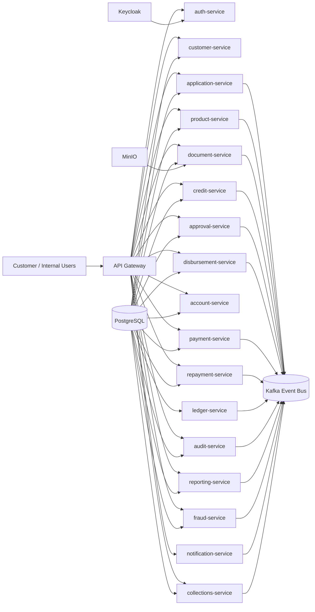

# OkCapital

This repository contains a modular Spring Boot microservice platform for a production-ready digital lending foundation. The implementation is intentionally staged and organized to support incremental delivery while remaining buildable and testable.

## Proposed architecture



## Compatibility decisions

- Java 25 is used as the target toolchain in Gradle.
- Spring Boot 3.5.6 with Spring Cloud 2025.0.x is the stability baseline that aligns with Java 25.
- PostgreSQL 16 is used for local development.
- All services share the local PostgreSQL server but connect to separate databases; Compose creates one database per service on first initialization.
- The PostgreSQL initialization script runs only when its data volume is first created. For an existing volume, provision the databases with `docker compose exec -T postgres psql -U okcapital_app -d okcapital_platform < infrastructure/postgres/init-databases.sql`.
- Kafka is configured in KRaft mode for local Docker development.
- Keycloak and MinIO are used as external local dependencies, not custom implementations.

## Service boundaries

The platform follows a domain-oriented service map aligned with the master prompt. The repository currently contains a buildable skeleton for all services, with standard Spring Boot configuration, health endpoints, and service-specific packages. Business logic remains deliberately staged to keep the system maintainable while the foundations are established.

## Kafka topic mapping

Key topics are defined in docs/kafka-topic-catalog.md. They include application, approval, payment, disbursement, repayment, fraud, notification, and audit domains.

## Implementation plan

1. Foundation and dependency compatibility
2. Gateway and auth setup
3. Customer, product, and application services
4. Document, credit, and approval flows
5. Financial lifecycle services
6. Supporting services and observability
7. Docker and end-to-end test validation

## Setup for local development

Use the repo helper scripts to prepare the local infrastructure and run services without repeating the raw Docker and Gradle commands.

```bash
./scripts/setup-dev.sh
./scripts/dev-up.sh
./scripts/run-service.sh api-gateway
./scripts/dev-down.sh
```

The scripts cover the common local workflow:
- `./scripts/dev-up.sh` starts PostgreSQL, Kafka, Keycloak, and MinIO
- `./scripts/dev-down.sh` stops the infrastructure stack
- `./scripts/run-service.sh <service-name>` launches a Spring Boot service with Gradle
- `./scripts/setup-dev.sh --verify` checks the environment and runs `./gradlew test`

## Environments

The project defines three Spring profiles: `development`, `staging`, and `production`.
Local service runs and Docker Compose use `development`. To run a service with another
profile, set `SPRING_PROFILES_ACTIVE` when launching it, for example:

```bash
SPRING_PROFILES_ACTIVE=staging ./gradlew :api-gateway:bootRun
SPRING_PROFILES_ACTIVE=production ./gradlew :api-gateway:bootRun
```

Shared profile-specific settings are in `config/application-<profile>.yml` and are
packaged into each service. Supply environment-specific endpoints and secrets through
the deployment environment; do not store them in profile files.

Swagger UI and OpenAPI docs are enabled for every service in the `development` and
`staging` profiles, and disabled in `production`. Open
`http://localhost:<service-port>/swagger-ui/index.html` for Swagger UI or
`http://localhost:<service-port>/v3/api-docs` for the OpenAPI document.

## Build and run

```bash
./gradlew projects
./gradlew test
./gradlew bootJar
docker compose up -d
```

## Deliverables status

- Architecture documentation: included
- Multi-service Gradle scaffold: included
- Docker Compose foundation: included
- Service skeletons: included for all requested services
- Full production business implementation: staged in this repository as a buildable foundation, with explicit production prerequisites documented

## External integration status

- Credit bureau: credit-service exposes a configurable TransUnion pull endpoint using `TU_API_URL` and `TU_ACCESS_TOKEN`. It sends the normalized JSON request described in [service-matrix.md](./docs/service-matrix.md) with a pre-issued bearer token; adapt the request/authentication for the contracted TU product as needed. No provider URL or credentials are hard-coded.
- Payment gateways: mock provider placeholder
- Notification channels: mock provider placeholder
- Fraud external services: mock provider placeholder
- Document storage: MinIO local development configuration

## Production prerequisites

- Real Keycloak realm and client configuration
- Kafka ACL and SASL/TLS production setup
- secrets management (Vault / Cloud KMS)
- PostgreSQL HA and backups
- TLS termination and gateway protections
- OTel exporter and monitoring stack
