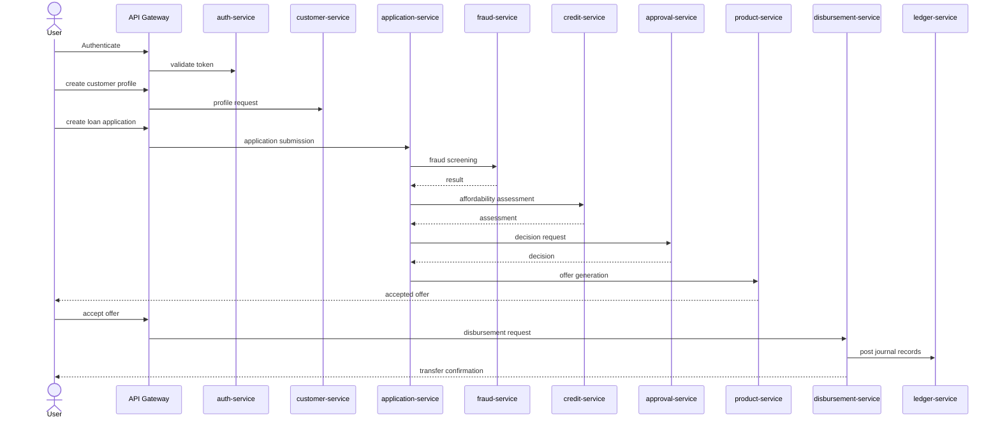

# Architecture notes

## Context and goals

The system is organized around a shared event backbone, service-specific persistence, and a centralized API gateway. Each service owns its database and only shares information through HTTP or Kafka events.

## Mermaid diagram



## Service responsibility matrix

| Service | Primary responsibility | Data ownership |
| --- | --- | --- |
| auth-service | identity and token validation | users, roles, clients |
| customer-service | customer profile and KYC state | customer master data |
| application-service | application lifecycle | applications, state history |
| document-service | documents and metadata | document metadata |
| credit-service | risk and affordability | credit policy and assessment results |
| approval-service | underwriting decisions | approvals and reasons |
| product-service | pricing and offers | products and offers |
| disbursement-service | payout orchestration | payout instructions |
| account-service | loan account lifecycle | loan accounts and balances |
| repayment-service | amortization and payment allocation | schedules and installments |
| payment-service | external payment integration | payment attempts |
| ledger-service | accounting journal | postings and lines |
| audit-service | security and operations trail | audit records |
| fraud-service | suspicious activity detection | fraud results |
| collections-service | delinquency follow-up | cases and activities |
| reporting-service | read-optimized analytics | reporting tables |
| api-gateway | routing and policy enforcement | gateway config |

## HTTP error handling

All Spring MVC services and the API gateway include the shared error handler from
`shared-kernel`. Error responses use a common JSON shape:

```json
{
  "timestamp": "2026-10-11T05:50:22Z",
  "status": 400,
  "error": "Bad Request",
  "message": "Request validation failed",
  "path": "/api/customers",
  "details": {
    "email": "must be a well-formed email address"
  }
}
```

Request validation and malformed input return `400`; missing resources return
`404`; data-integrity conflicts return `409`; and unsupported methods or media
types return `405` or `415`. Unexpected server errors are logged and return a
generic `500` message without exposing internal exception details. Service-specific
errors retain their HTTP status while using the same response shape.
